# Pictures people can take off the site

Everything on My Planet View that turns into an image file people can share, save, download or print: where the button is, what the picture shows, and what file comes out.

The pictures in this folder are the real files the site made on 24 and 25 Nov 2026, saved through its own buttons. They use the mock mode's demo map, "Charlie & Alex's travels". The `-window.png` files are screenshots of the window each one comes from.

## At a glance

| What | Where to find it | What comes out | Who sees the button |
| --- | --- | --- | --- |
| [Picture of the map](#1-a-picture-of-the-map) | Statistics → **Share a picture of my map** | 1080 × 1350 PNG | Anyone on the map |
| [Poster](#2-a-poster-of-the-map) | Statistics → **A poster of my map** | Print-size PNG, 300 dpi | Anyone on the map |
| [Year in travel](#3-your-year-in-travel) | Statistics → **Your year in travel**, last slide | 1080 × 1350 PNG | Anyone on the map |
| [Trip picture](#4-a-picture-of-a-trip) | The **Welcome home** tag after a trip ends → **Share a picture** | 1080 × 1350 PNG | Editors |
| [Medal picture](#5-a-country-collection-medal) | Badges and goals → Country collections → **Share** | 1080 × 1350 PNG | Editors |
| [Life's One Shots](#6-lifes-one-shots) | Life's One Shots → **Share a picture** | 1080 × 1350 PNG | Editors |
| [Print or download photos](#7-print-or-download-the-photos) | A country's ticket → **Print or download** (also on trips and in Settings) | A zip of the original photos | Editors |
| [Compare maps](#8-compare-two-maps) | Statistics → **Compare with another map** | Shown on the page only, no download | Signed-in people |
| [A new badge or goal](#9-a-new-badge-or-goal) | The pop-up when a badge is earned or a goal reached → **Share a picture** | 1080 × 1350 PNG | Editors |

None of these buttons appear on a share link (`/shared/...`), so someone viewing a shared map can't make pictures of it.

## How the share pictures work (1, 3, 4, 5, 6 and 9)

Six of these are "share cards". They all work the same way:

- **The size is 1080 × 1350 pixels**, a portrait 4:5 shape. That's Instagram's tallest feed post, and it suits WhatsApp and Stories too.
- **The window draws it in the browser** and shows it straight away. Nothing is sent to our server.
- **Where the browser can hand a file to other apps, there's a "Share" button.** That means phones, and some computers (Chrome and Edge on Windows). It opens the device's own share sheet (Instagram, WhatsApp, Messages and so on) with the picture attached.
- **There's always "Save the picture"**, which downloads the PNG. On a computer that can't share files, it's the only button.
- **The window shows the post as it will look** (since 25 Nov 2026): the picture with its words under it in a box ("Words to go with it"). People can change the words; **Share** sends them with the picture, and **Copy the words** copies them, because Instagram leaves out words handed to it, so they're pasted there instead.
- **They show countries and numbers, never the person's photos.** The window says so.
- **Every card has `myplanetview.com` printed at the bottom.** That's the advertising: every shared picture carries the address.
- **The colours are fixed**, whatever map style is chosen. A map that has its own design (custom country colours) uses those colours on the card.
- **Some cards can show their places close up** instead of the whole world. One country gets its own map with its states or provinces, each in its colour. A few countries near each other get the world cropped round them, never closer than a few countries across. Places spread far apart, or Antarctica or a pole, keep the whole world. The trip card always does this; the year card lets people choose.

---

## 1. A picture of the map

**How:** open the map → the **Travel statistics** stamp in the toolbar → **Share a picture of my map** → **Share** (phone) or **Save the picture** (computer).

**What it shows:** "My travel map", the map's name, the world with every country visited or lived in coloured, three big numbers (countries, continents, and landmarks stamped, or photos or trips if there are none), and every country's name.

**File:** `my-planet-view-map.png`

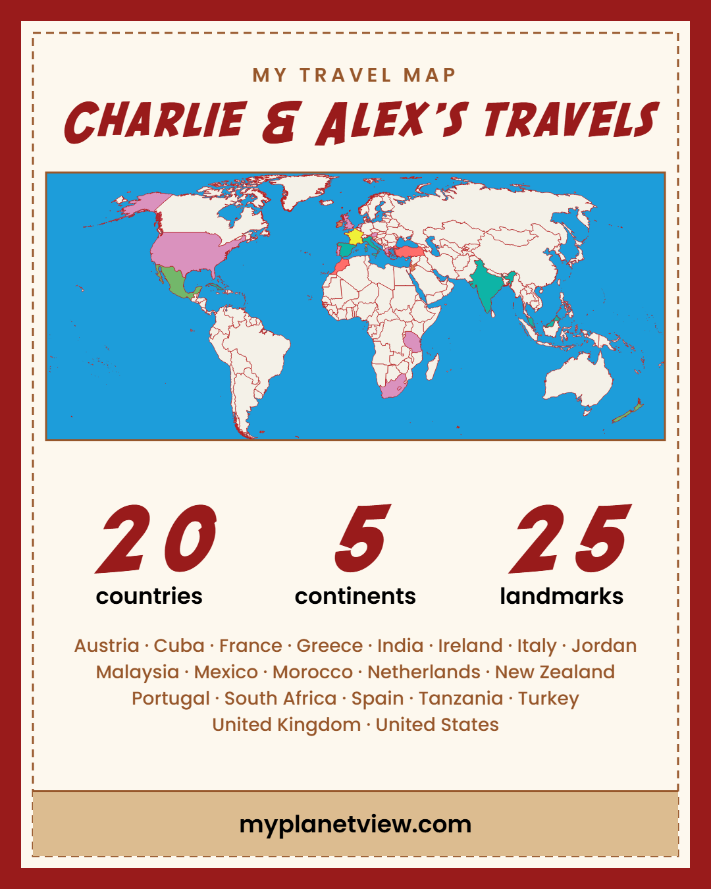

The window it comes from

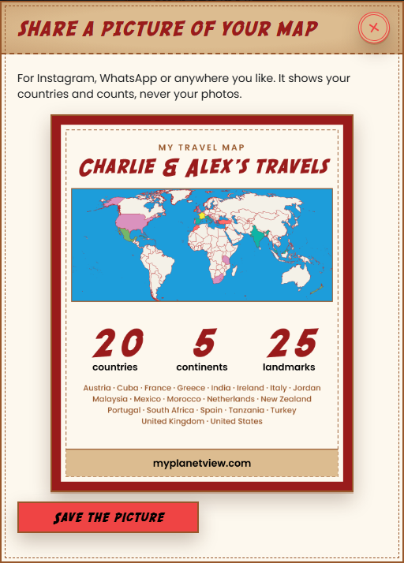

## 2. A poster of the map

**How:** **Travel statistics** → **A poster of my map**. Choose:

- **Paper size:** A4, A3 (the default), A2 or 70 × 50 cm, all landscape.
- **Look:** "Blue sea" or "Old paper".
- **Title:** the map's name to start with; it can be changed (80 characters at most).
- **Name the countries under the map:** on to start with.

Then press **Download the poster**.

**What it shows:** the title, a line of numbers ("20 countries · 5 continents · 8.8% of the world"), the map with the countries coloured, the countries' names, and `myplanetview.com`.

**File:** `<map name>-poster-<size>.png`, for example `charlie-alex-s-travels-poster-A3.png`. It's made at 300 dpi, so A4 is 3508 × 2480 pixels and A3 is 4961 × 3508. A phone whose browser can't draw that big gets a lower dpi (250, 200 or 150), and the window says which it got.

**Printing:** under the button, **Have it printed** lists our print partners' offers (in the demo, the made-up "Example Prints"). The person uploads the poster on the printer's site and orders there; we don't send it for them.

The two files here are A4, to keep the repo small. A3 and larger look the same, only bigger.

| Blue sea | Old paper |
| --- | --- |
| 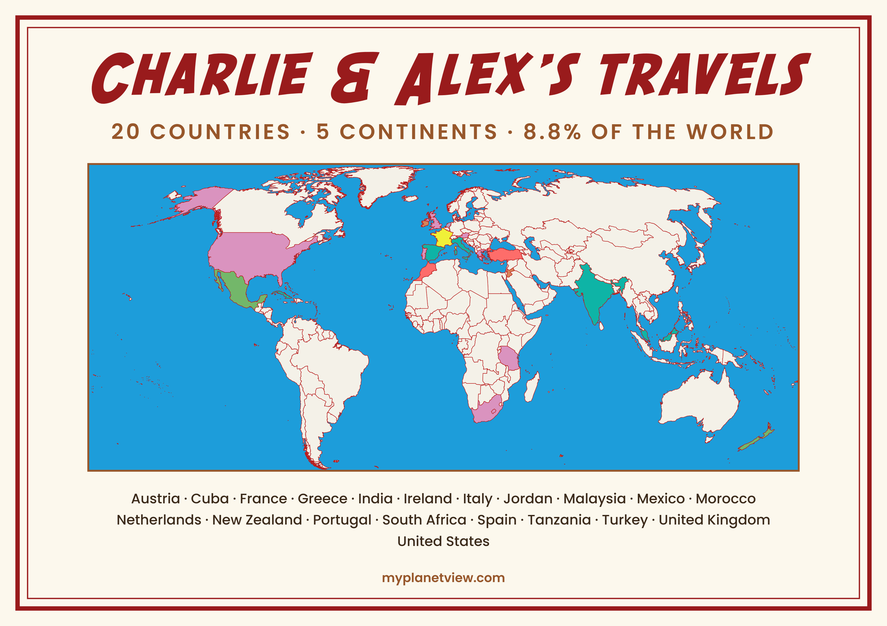 | 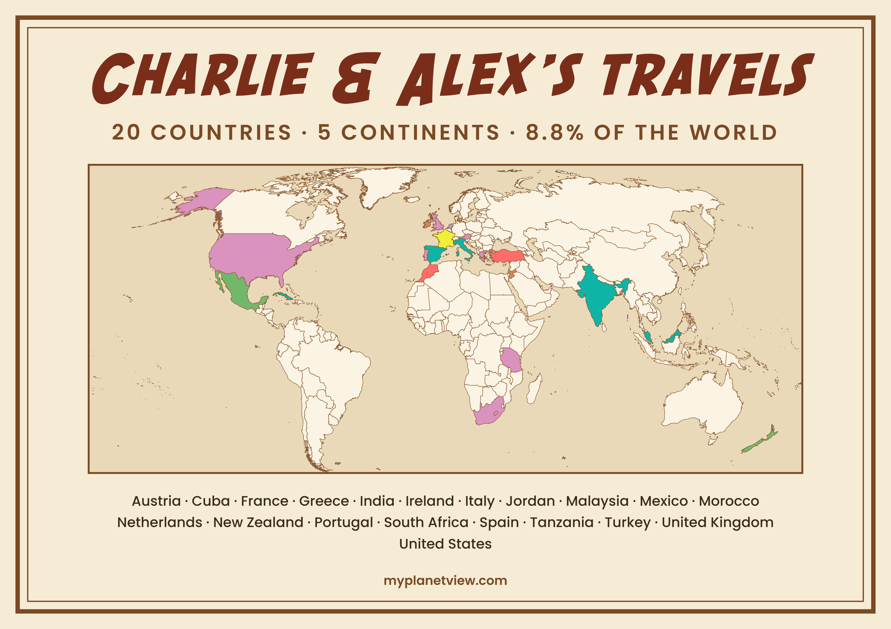 |

The window it comes from

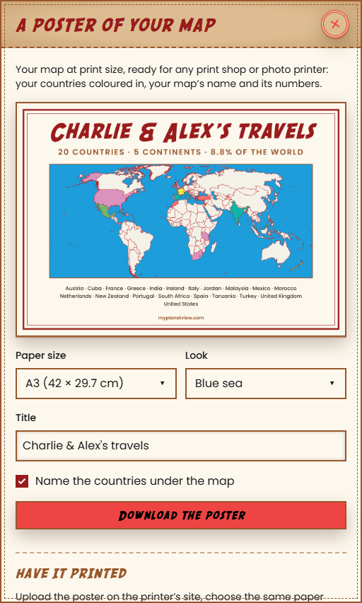

## 3. Your year in travel

**How:** **Travel statistics** → **Your year in travel**. Pick the year at the top, then press **Next** through the slides (places, photos, stamps, trips and moments). The last slide, "Share your 2025", has the picture with **Share** / **Save the picture**.

In December and January a tag on the map also offers the year.

**What it shows:** the map's name, "2025 in travel", the countries visited that year coloured, up to three numbers (countries, new countries, photos, else landmarks or trips), and the countries' names.

**The map:** above the picture, **The map on the picture** offers **Whole world** (the default) or **Close up**. The choice only shows when a close-up would differ from the world, i.e. when the year's places are near each other.

**File:** `my-planet-view-<year>.png`, either way.

| Whole world | Close up |
| --- | --- |
| 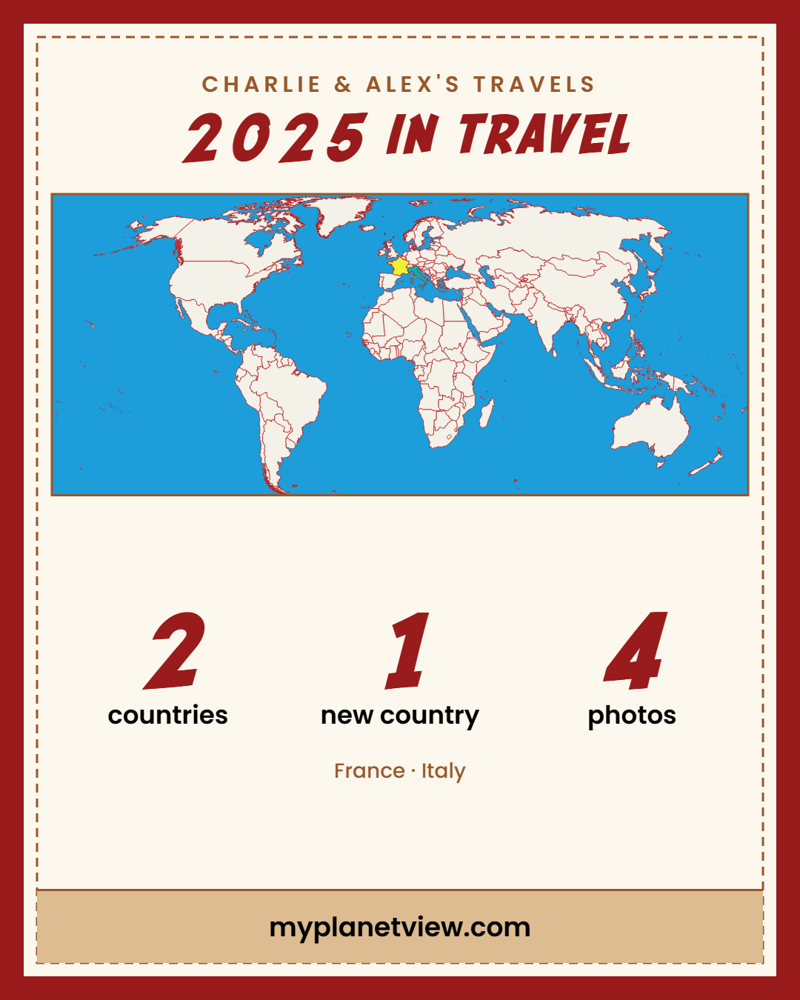 | 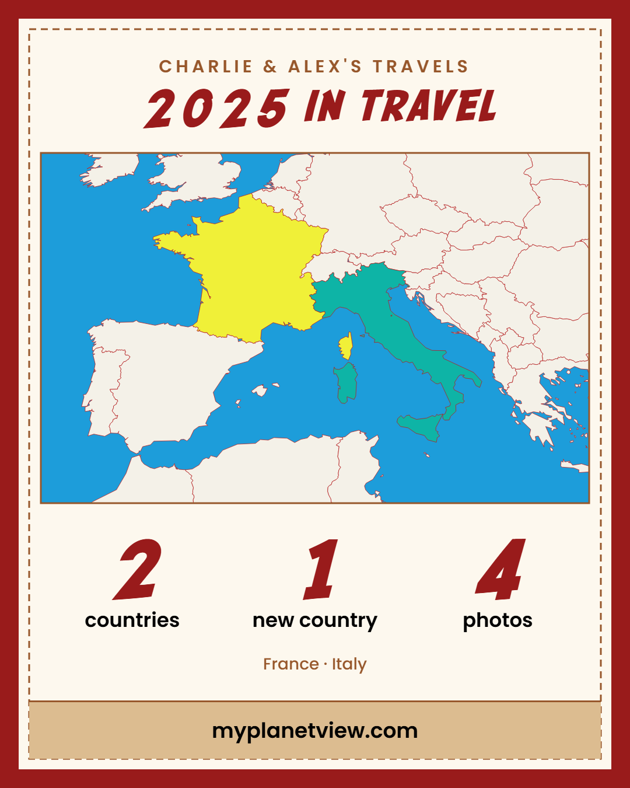 |

The window it comes from

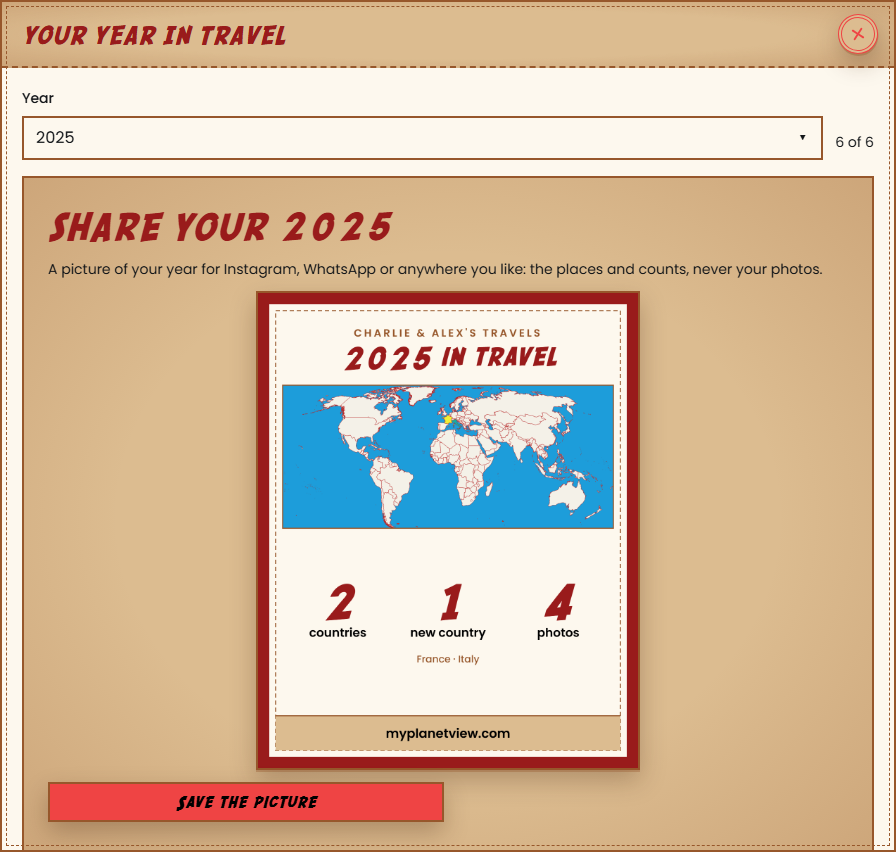

## 4. A picture of a trip

**How:** the day after a trip ends, a **Welcome home** tag appears on the map for 14 days. Press **Share a picture** on it. The "Welcome home" email links to the same thing.

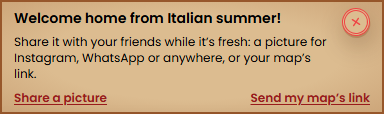

There's no other button for it yet. Once the 14 days are over, or the tag has been closed, the trip picture can only be made by following the email's link again (it brings the tag back).

**What it shows:** "My trip", the trip's title, its countries coloured, and how many countries, days and photos. The map is always close up:

- **One country:** that country's own map with its regions (the sample, a trip to Italy).
- **A few neighbouring countries** (Spain and Portugal): the world cropped round them.
- **Countries far apart:** the whole world.

**File:** `my-planet-view-trip.png`

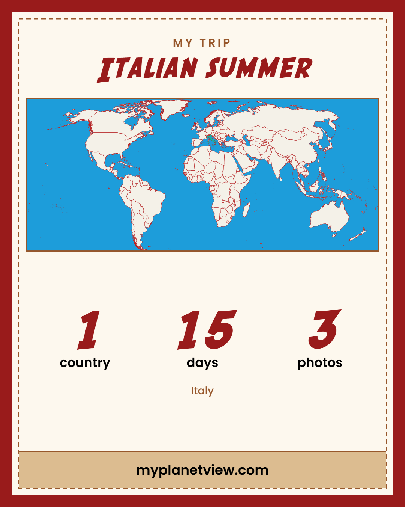

The window it comes from

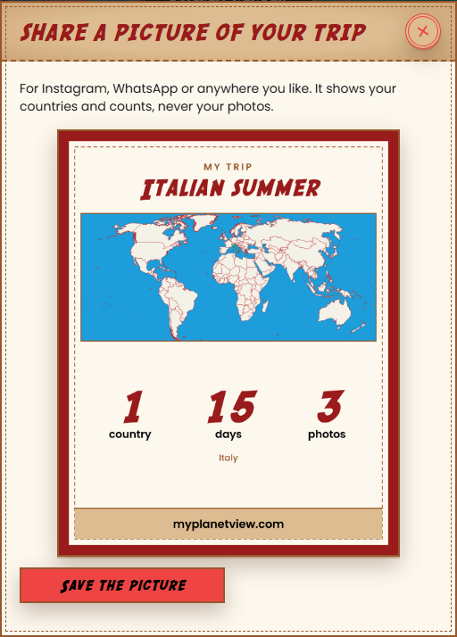

## 5. A country collection medal

**How:** **Badges and goals** → the **Country collections** section → **Share** beside a country's medals. It shares that country's best medal.

People earn bronze, silver and gold for stamping a quarter, half and all of a country's landmarks. The sample is Malta, gold: all three of its landmarks were ticked "Been here".

**What it shows:** "Gold medal", the country, the medal drawn big where the map would be, and "3 landmarks stamped / 3 landmarks in Malta".

**File:** `my-planet-view-<country code>-<medal>.png`, for example `my-planet-view-mt-gold.png`

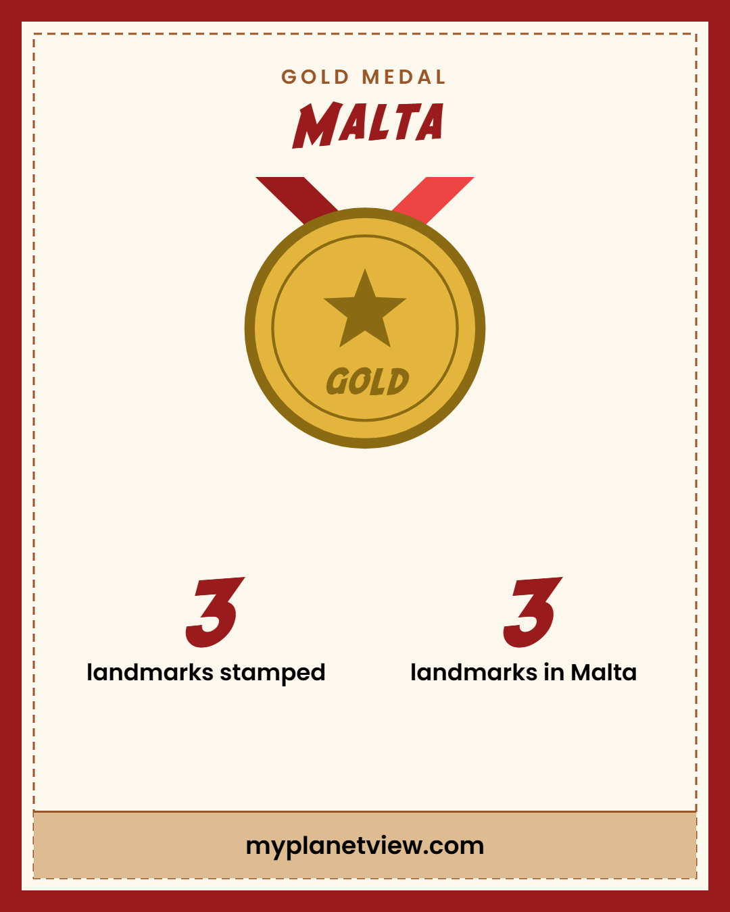

The window it comes from

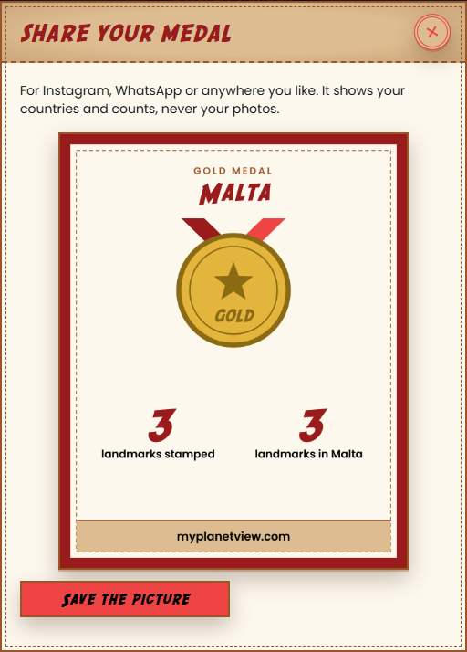

## 6. Life's One Shots

**How:** the **Life's One Shots** stamp in the toolbar → **Share a picture** (it shows once at least one item is ticked).

**What it shows:** "Life's One Shots", the map's name, the countries where things were seen or done coloured, and how many animals, wonders and journeys are ticked.

**File:** `my-planet-view-one-shots.png`

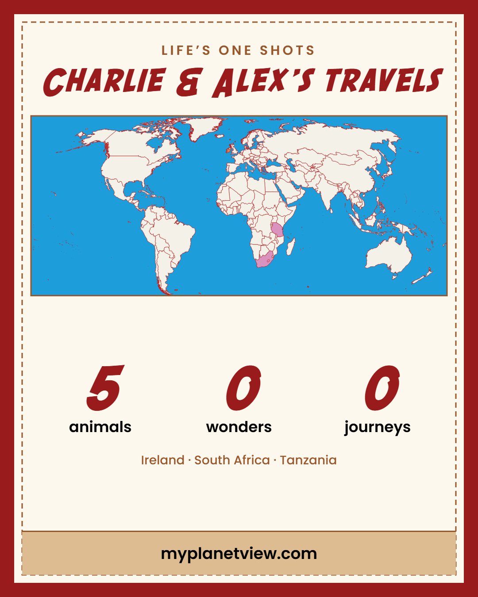

The window it comes from

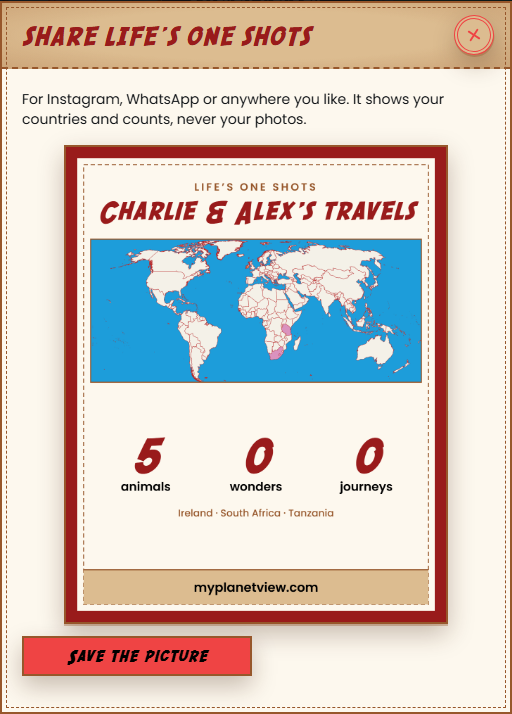

## 7. Print or download the photos

This one isn't a picture we make: it gives people their own photos back.

**How:** **Print or download** on a country's ticket (that country's photos), on a trip's page (the trip's photos), or in Settings → "This map" (every photo, in a folder per country). Then press **Download the zip**.

**What comes out:** a zip of the best copy of each photo: the original as uploaded on paid plans, or the 2,400 px print copy on Economy. Videos aren't included. Where the browser can save straight to disk (Chrome, Edge), it's one zip of any size; elsewhere, large downloads come as several zips of up to 500 MB each.

**Worth knowing:** the originals still hold where each photo was taken (GPS), and the window warns about that before people pass the files on.

**Printing:** **Print them** lists our print partners' offers. As with the poster, people upload the photos on the printer's site themselves.

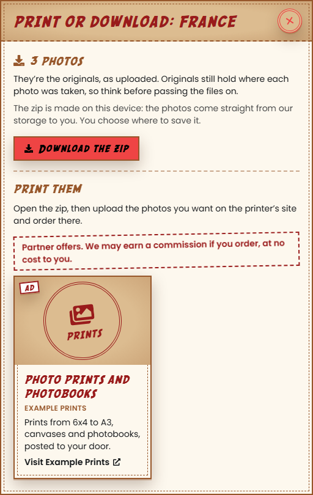

## 8. Compare two maps

**How:** **Travel statistics** → **Compare with another map**, then choose the second map (one of your own, one shared with you, or a share link).

**What it shows:** the world with the countries both maps have been to in purple, only the first map's in orange and only the second's in teal. Lists under it name them.

It's shown on the page only: there's no Share or Save button, so people would have to screenshot it.

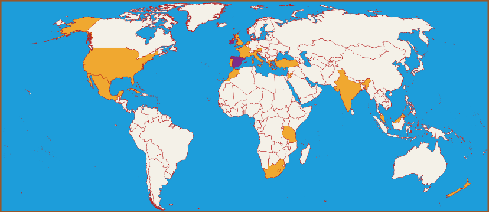

## 9. A new badge or goal

**How:** when a badge is earned or a goal reached, a pop-up says so at the top of the map for 20 seconds → **Share a picture**. When several arrive at once ("New badges: South America and Six continents."), buttons at the top of the window choose which one to share.

**What it shows:** for a badge, "Badge earned" and the day, its name, its sticker drawn big (the same sticker as in the badge suitcase: its icon, its number if it has one, and the tick), the map's three numbers, and what the badge is for. A country collection's medal shows the medal card (see 5). A goal shows its places on the map (close up for a list or a region, the whole world for a count) with "Goal reached" and its numbers.

**Words to go with it:** "New badge on my travel map: South America! 21 countries so far." or "Goal reached on my travel map: Our bucket list!"

**File:** `my-planet-view-badge-<badge>.png` (for example `my-planet-view-badge-continent-south-america.png`), `my-planet-view-goal.png`, or the medal's name.

The sample: Peru marked visited on the demo map, which earned South America and Six continents at once.

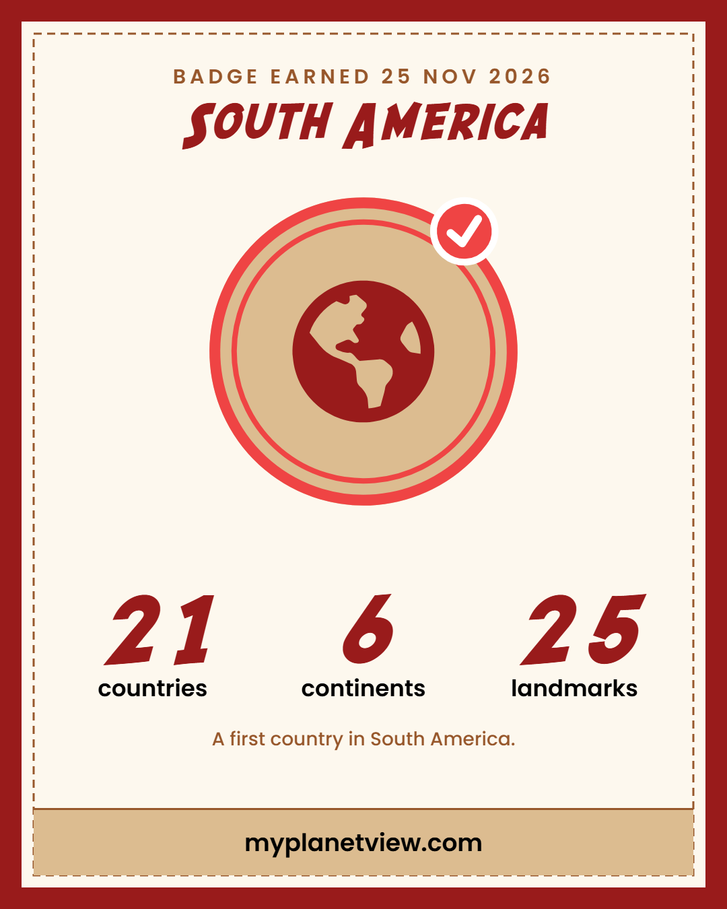

The window it comes from

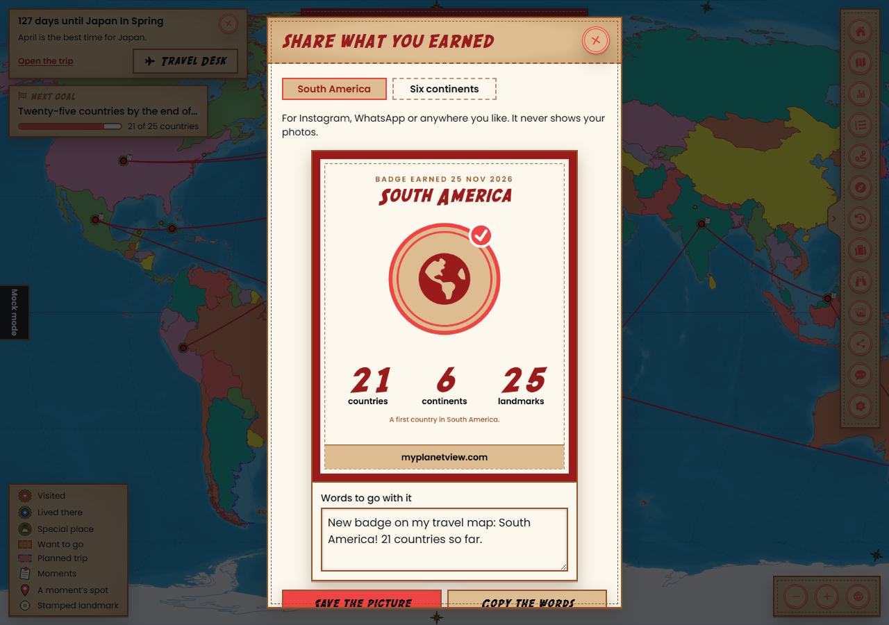

---

## Not pictures, but also ways to share

These hand over a link, not a file:

- **The map's share link:** the Share stamp → sharing dialog → copy the link (`/shared/<code>`).
- **A map on your website:** the sharing dialog → **On your website**, an `<iframe>` code for the person's own site or blog (`/embed/<code>`).
- **Guess where I was:** Statistics → **Guess where I was: a game for friends**, a link to a photo-guessing game (`/guess/<code>`).
- **A slideshow of chosen photos:** **Share a slideshow** in the photo album, a country's ticket or a trip's photos, a link that plays just the photos picked, starting with its title (`/show/<code>`). The map's share dialog lists them, to rename, give a new link or delete. Editors only.
- **Welcome home → Send my map's link:** opens the sharing dialog.

## Things I noticed while making these

- **The medal card has a wide empty band** between the medal and its two numbers.
- **The compare picture can't be saved or shared** (see 8), although it's the kind of picture people might want to post.
- **The trip picture is only reachable from the Welcome home tag** (see 4): for 14 days after a trip, or from the email's link.
- **Every picture prints `myplanetview.com`,** which isn't registered yet.
